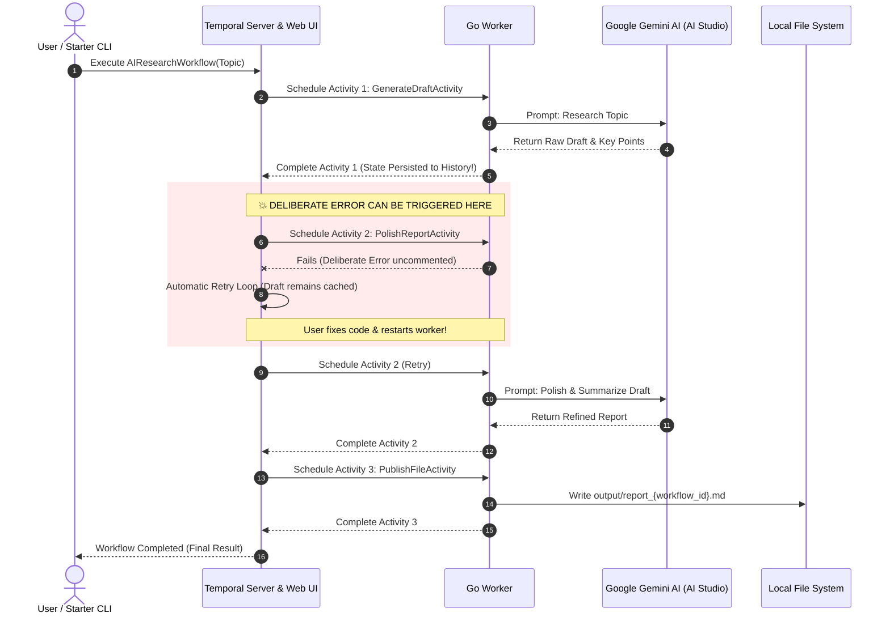

# ⚡ Temporal with AI (Google Gemini LLM) Demo in Go

A hands-on demonstration showing why **[Temporal](https://temporal.io)** is the ideal orchestrator for **AI Agents and multi-step LLM pipelines**.

This project demonstrates **Durable Execution**, **Fault Tolerance**, and **State Persistence** using Go and **Google AI Studio (Gemini)**.

---

## 💡 Why Temporal for AI Workflows?

Modern LLM workflows involve multiple sequential prompts, tools, and API calls. However:
1. **LLM calls are expensive and slow**: Generating a research draft can take 5–15 seconds and cost significant token budget.
2. **APIs fail**: Rate limits (HTTP 429), timeouts, downstream network glitches, or bugs in post-processing can crash traditional scripts midway.
3. **Without Temporal**: If step 3 of a 4-step pipeline crashes, you must rerun the entire script from the start—wasting time, repeating previous LLM calls, and double-paying for tokens.
4. **With Temporal**: Every completed Activity's input and output is durably persisted in event history. When an error occurs:
   - Temporal pauses and retries according to your retry policy.
   - You can fix the bug in code **while the workflow is active**.
   - Temporal resumes execution **exactly where it failed**—without re-executing already completed LLM steps!

---

## 🏗️ Architecture



---

## 📁 Project Structure

```
.
├── Makefile                # Convenient commands (server, worker, start)
├── README.md               # Documentation & demo walkthrough
├── .env.example            # Environment template for Google AI Studio key
├── config/
│   └── config.go           # Simple .env configuration loader
├── workflow/
│   ├── types.go            # Data structures & workflow input/output models
│   ├── gemini.go           # Google AI Studio Gemini client (with simulation mode)
│   ├── activities.go       # Temporal Activities (contains the deliberate error switch!)
│   └── workflow.go         # Workflow definition, queries, and retry policy
├── worker/
│   └── main.go             # Worker process listening on AI_RESEARCH_TASK_QUEUE
├── starter/
│   └── main.go             # CLI to trigger workflows and stream live status
└── output/                 # Markdown reports published by completed workflows
```

---

## 🚀 Quick Start

### 1. Prerequisites
- **Go 1.22+**
- **Temporal CLI** (`brew install temporal` on macOS)

### 2. Configure Google AI Studio (Optional but Recommended)
Get a free Gemini API key from [Google AI Studio](https://aistudio.google.com/app/apikey).

Copy `.env.example` to `.env`:
```bash
cp .env.example .env
```

Set your API key in `.env`:
```env
GEMINI_API_KEY=AIzaSy...
GEMINI_MODEL=gemini-3.8-flash
```

> **Note**: If you don't provide an API key, the demo automatically runs in **Simulation Mode** with realistic delays and rich mock responses, so you can test Temporal workflows immediately!

---

## 🎬 Hands-on Walkthrough: Creating a Deliberate Error

### Step 1: Start Temporal Dev Server
Open a terminal and run:
```bash
make server
# Or: temporal server start-dev
```
Temporal Web UI will be running at: **[http://localhost:8233](http://localhost:8233)**

---

### Step 2: Uncomment the Deliberate Error in Code
Open [`workflow/activities.go`](file:///Users/tural/d/projects/personal/code/temporal/workflow/activities.go) and find `PolishReportActivity`.

Uncomment the deliberate error return statement:

```go
// UNCOMMENT THE LINE BELOW TO CAUSE A DELIBERATE ERROR:
return nil, fmt.Errorf("💥 DELIBERATE DEMO ERROR: Database connection failed / API rate-limit exceeded! Notice that Activity 1 (Draft) is ALREADY SAVED in Temporal history and will NOT re-run. Comment this line back out and restart the worker to recover!")
```

Save the file.

---

### Step 3: Start the Worker
In a second terminal:
```bash
make worker
```
You will see the worker register the workflow and activities and listen on `AI_RESEARCH_TASK_QUEUE`.

---

### Step 4: Launch the AI Workflow
In a third terminal:
```bash
make start
```
*(Or specify a custom topic: `make start-topic TOPIC="Agentic AI in Go" AUDIENCE="Engineers"`)*

---

### Step 5: Observe State Persistence in Action!

1. **In the Terminal**:
   - `Activity 1 (GenerateDraftActivity)` runs and calls the Gemini LLM. It succeeds and logs:
     ```
     [Activity 1: Draft] ✅ Draft successfully created! (1240 characters)
     [Activity 1: Draft] 💾 [TEMPORAL PERSISTENCE] Output is now safely saved in Temporal event history.
     ```
   - Next, `Activity 2 (PolishReportActivity)` executes and immediately hits your deliberate error:
     ```
     💥 DELIBERATE DEMO ERROR: Database connection failed / API rate-limit exceeded!
     ```
   - Temporal detects the activity failure and begins retrying with exponential backoff.

2. **In Temporal Web UI ([http://localhost:8233](http://localhost:8233))**:
   - Click on your running workflow execution.
   - Look at the timeline / history:
     - **Activity 1 is marked Completed**. Click on it to see the raw LLM draft stored in the JSON payload!
     - **Activity 2 is marked Retrying**. Click on it to see the error message and retry attempts.

---

### Step 6: Fix the Code Live & Watch Temporal Resume!

1. Go back to [`workflow/activities.go`](file:///Users/tural/d/projects/personal/code/temporal/workflow/activities.go) and **comment out** the error line again:
   ```go
   // return nil, fmt.Errorf(...)
   ```
2. Stop the worker in Terminal 2 (`Ctrl + C`) and restart it:
   ```bash
   make worker
   ```
3. **Watch what happens**:
   - The worker picks up the retrying workflow.
   - **Activity 1 is NOT re-executed!** (No wasted Gemini API calls, no token charges).
   - Activity 2 immediately succeeds using the draft stored in Temporal history!
   - Activity 3 publishes the final report to `output/report_<workflow_id>.md`.
   - The workflow finishes with status `SUCCESS`!

---

## 🔍 Key Temporal Concepts Demonstrated

| Feature | How this Demo Demonstrates It |
| :--- | :--- |
| **Durable Execution** | The workflow state survives worker restarts and code crashes. |
| **Automatic Retry Policy** | Configured in `workflow.go` with backoff and retry intervals. |
| **Zero Token Waste** | LLM responses in earlier activities are never lost or re-billed when later steps fail. |
| **Live State Queries** | `c.QueryWorkflow(ctx, id, runID, "getStatus")` streams live progress to the CLI. |
| **Visual Observability** | The Web UI provides a full audit log of every prompt, response, and retry. |
